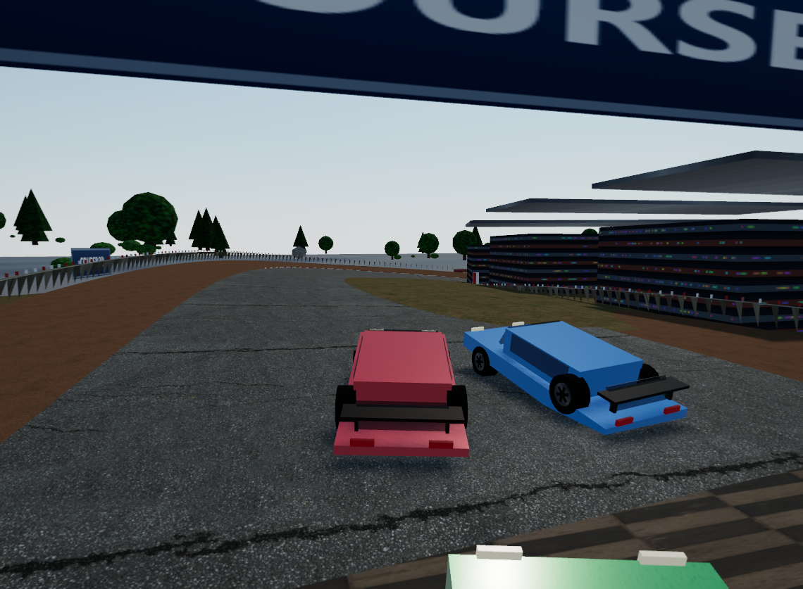

# Course 3D

Reprise en 3D du jeu de course : moteur physique complet, circuits en
relief et adversaires pilotés par une IA, autour de
[three.js](https://threejs.org/).



> **État du projet — jouable.**
> Le jeu se lance (`npm run dev`), les dix circuits sont validés par le banc
> d'essai IA, et le rendu 3D est en place : voiture, décor, caméra de
> poursuite et effets de vitesse. Chaque objet du décor est texturé et un
> validateur le vérifie à chaque chargement.

## Installation

Le plus simple, sous Windows : **double-cliquez sur `demarrer.cmd`**, à côté de
`index.html`. Le script installe les dépendances au premier lancement, démarre
le serveur et ouvre le navigateur. Fermer la fenêtre arrête le jeu.

En ligne de commande :

```powershell
cd course-voitures-3d
npm install
npm run dev
```

puis ouvrir l'adresse affichée par Vite (http://127.0.0.1:5173 par défaut).

Le lanceur (`npm start`, ou `node demarrer.mjs`) fait la même chose que
`npm run dev`, avec deux différences : il ouvre le navigateur tout seul, et il
**réutilise un serveur déjà lancé** au lieu d'en démarrer un second. Options :
`--sans-navigateur`, et la variable `PORT` (par défaut 5173).

Les textures sont **versionnées** : `npm run fetch:textures` et
`npm run optimize:textures` ne servent qu'à les régénérer.

Scripts disponibles :

| Script | Rôle |
| --- | --- |
| `npm start` | lance le jeu et ouvre le navigateur (`demarrer.mjs`) |
| `npm run dev` | serveur de développement Vite |
| `npm run build` | build de production |
| `npm run preview` | prévisualisation du build |
| `npm run fetch:textures` | télécharge les textures Poly Haven (CC0) |
| `npm run optimize:textures` | compresse les textures téléchargées |
| `npm run bench` | banc d'essai IA des circuits |
| `npm test` | tests unitaires (`node --test`) |
| `npm run setup:git` | applique la configuration Git du dépôt (script racine) |

`fetch:textures` télécharge les textures **CC0** de Poly Haven (asphalte,
gravier, herbe, béton, dalles) dans `public/textures/` — environ 5,6 Mo une fois
optimisées par `optimize:textures`. Le catalogue des assets, leurs URL et leurs
licences sont listés dans `public/textures/SOURCES.json`.

Les textures sont **versionnées** : elles sont régénérables à l'identique, mais
leur poids reste raisonnable et cela évite un téléchargement à l'installation.

## Modules

```text
src/core/mathx.js     utilitaires mathématiques (clamp, lerp, moveTowards…)
src/core/physics.js   moteur physique du véhicule
src/core/track.js     construction géométrique d'un circuit
src/core/tracks.js    catalogue des circuits
src/core/ai.js        pilotes automatiques
src/core/race.js      déroulement d'une course (tours, positions, arrivée)
src/core/input.js     correspondance clavier → commandes de conduite
src/render/scene.js   scène, lumières, ciel, post-traitement
src/render/trackMesh.js  route, vibreurs, glissières, terrain, run-off
src/render/scenery.js     décor instancié (arbres, tribunes, panneaux…)
src/render/proceduralTextures.js  textures dessinées au canvas 2D
src/render/validation.js  valideur « chaque objet porte une texture »
src/render/carMesh.js    modèle de voiture (construit par code)
src/render/camera.js      caméra de poursuite
src/render/effects.js     shader des effets de vitesse
src/render/speedPass.js   passe de post-traitement (voir docs/rendu.md)
src/ui/interface.js       menu, HUD, résultats
src/main.js         point d'entrée
tests/                tests unitaires (node --test)
docs/architecture.md  pourquoi le projet est découpé ainsi
docs/rendu.md         les pièges du rendu Three.js rencontrés
public/textures/      textures CC0 (Poly Haven), versionnées
tools/fetch-textures.mjs       téléchargeur de textures
tools/optimize-textures.mjs    compression des textures
tools/bench.mjs                  banc d'essai IA des circuits
demarrer.cmd          lanceur Windows (double-clic)
demarrer.mjs          logique du lanceur (Node)
```

`three.js` n'est pas embarqué : il vient de `node_modules` et est résolu par
Vite au moment du build.

## Architecture

Le principe directeur est simple : **`src/core/` ne contient aucune référence au
DOM ni à Three.js**. La simulation s'exécute donc sous Node, sans navigateur et
sans rendu — c'est ce qui rend possible le banc d'essai `npm run bench`.

Le raisonnement complet est dans [`docs/architecture.md`](docs/architecture.md).

## Tests

```powershell
npm test
```

Les tests couvrent le comportement observable du modèle physique
(accélération, freinage, sens de rotation, dérapage au-delà de l'adhérence,
respect des limites du circuit) et la construction géométrique des circuits.

Les modules de `src/core/` sont **purs** : aucun accès au DOM, ce qui les rend
utilisables sous Node pour des tests.

Un test dédié (`tests/validation.test.js`) vérifie en plus que **chaque objet**
du décor des dix circuits — et chaque pièce de la voiture — porte une texture :
le validateur (`src/render/validation.js`) parcourt la scène et refuse tout
matériau uni, sauf vitres et phares.

## Banc d'essai

```powershell
npm run bench
```

Le banc d'essai fait piloter chaque circuit par l'IA, sans navigateur ni
rendu, et rapporte des métriques objectives : tours bouclés, temps au tour,
pourcentage hors piste, pertes de contrôle, blocages, écart maximal à l'axe
et vitesses atteintes.

Il sert de garde-fou : un circuit n'est livrable que si l'IA le boucle
proprement. Les dix circuits sont aujourd'hui validés (moyenne 93,2 sur 100,
0 % hors piste hors circuit urbain, aucun blocage).

## IA

Les pilotes automatiques combinent trois couches :

- **trajectoire** — suivi de la ligne de course par *pure pursuit*, avec
  correction d'écart latéral de type Stanley ;
- **vitesse** — planification à reculons : la vitesse d'entrée est calculée
  pour pouvoir freiner à temps jusqu'au virage, en tenant compte de la
  courbure et de la pente ;
- **tactique** — évitement et dépassement, contre-braquage quand l'arrière
  décroche, dégagement en marche arrière si la voiture est bloquée.

Trois niveaux : `calme`, `confirmé`, `expert`.

## Physique

Modèle bicyclette inspiré de *Vehicle Dynamics* (Pacejka), enrichi pour la 3D :

- **transfert de charge** longitudinal : squat et plongeon ;
- **formule magique** par essieu, avec courbe de dérive simplifiée ;
- **cercle de friction** : la force longitudinale consomme l'adhérence latérale ;
- **gravité projetée** : la pente fait accélérer la voiture en descente, le
  dévers pousse vers l'intérieur du virage ;
- **appui aérodynamique** proportionnel au carré de la vitesse ;
- **ESC** (correction électronique de stabilité) et contrôle de motricité.

Unités SI strictes : mètres, kilogrammes, secondes, newtons.

### Repères

- Monde : **X**, **Y** (haut), **Z** ;
- cap `heading` : `0` = +X, sens trigonométrique dans le plan XZ ;
- véhicule : **x** avant, **y** latéral (vers la droite du conducteur), **z** vertical.

## Circuits

| Identifiant | Nom | Environnement |
| --- | --- | --- |
| `genets` | Boucle des Genêts | lac (bord de l’eau) |
| `aiguille` | L'Aiguille | prairie |
| `cigogne` | La Cigogne | prairie |
| `escargot` | L'Escargot | prairie |
| `onde` | L'Onde | prairie |
| `saut` | Le Saut | neige (grande crête) |
| `esses` | Les Esses | prairie |
| `col` | Le Col | montagne |
| `horloge` | L'Horloge | désert (crépuscule) |
| `village` | Le Village | urbain |

Chaque circuit est décrit par une forme en plan — harmoniques polaires pour
les tracés courbes, polygone à angles droits raccordés par des congés pour
le circuit urbain. La boucle est fermée par construction, et `track.js` en
déduit la géométrie 3D, la surface roulable, le sens de parcours et les
points de contrôle.

## Reste à faire

- [ ] sons (moteur, adhérence, gravier) ;
- [ ] commandes de rattrapage après une sortie de piste ;
- [x] point d'entrée (`index.html` + `src/main.js`) et boucle de rendu ;
- [x] rendu 3D : maillage de la route, voiture, caméra de poursuite,
      effets de vitesse ;
- [x] interface (HUD, menu, résultats) ;
- [x] moteur physique et géométrie des circuits ;
- [x] pilotes automatiques et banc d'essai hors écran ;
- [x] tests sous Node des modules `src/core/`.

## Notes de rendu

Le rendu Three.js a posé plusieurs pièges, documentés dans
[`docs/rendu.md`](docs/rendu.md) : double conversion sRGB, tone mapping
appliqué deux fois, copie superflue du compositeur, échelle du ciel, ordre
des triangles. Ce sont des erreurs **visibles** mais silencieuses : le jeu
tourne, seule l'image est délavée. Elles ne se trouvent pas à la lecture du
code, mais en comparant des images.
